

<div align="center">

[](https://github.com/Luca-css)

[](https://luca-css.github.io)&nbsp;
[](https://www.linkedin.com/in/lucas-candido-0571b2407/)&nbsp;


</div>

---

## `> whoami`

<table>
<tr>
<td width="55%" valign="top">

```yaml
nome:     Lucas Santos
cargo:    Analista de TI N3 — Sênior
foco:     Cibersegurança · Automação · Engenharia de Sistemas
local:    Brasil 🇧🇷

atuação:
  - Detecção e resposta a incidentes (SOC / DFIR)
  - Hardening de Windows Server, Linux e Active Directory
  - Automação de operações de TI em escala
  - Desenvolvimento de serviços e ferramentas de segurança

stack_principal: [Go, Python, TypeScript, PowerShell]
status: 🟢 aberto a projetos e oportunidades
```

</td>
<td width="45%" align="center" valign="top">


</td>
</tr>
</table>

---

## `> cat stack.yml`

<div align="center">

| Camada | Tecnologias |
|:--|:--|
| **Linguagens** |        |
| **Backend & APIs** |      |
| **DevOps** |      |
| **Infra** |    |
| **Segurança** |       |

</div>

---

## `> ls ./featured --sort=impact`

<sub>Projetos completos — arquitetura em camadas, testes automatizados, CI e Docker.</sub>

<table width="100%">
<tr>
<td width="50%" valign="top">

### [`logpipe`](https://github.com/Luca-css/logpipe)
Pipeline de logs de alta vazão: **sources → processors → sinks** com backpressure, *graceful shutdown*, redação de dados sensíveis (LGPD) e métricas Prometheus.

  <br/>
[](https://github.com/Luca-css/logpipe/actions)

</td>
<td width="50%" valign="top">

### [`opsflow`](https://github.com/Luca-css/opsflow)
Motor de automação de operações de TI: runbooks em YAML executados como **DAG** assíncrono, com retries, timeouts, plugins e histórico de execuções.

  <br/>
[](https://github.com/Luca-css/opsflow/actions)

</td>
</tr>
<tr>
<td width="50%" valign="top">

### [`siem-dashboard`](https://github.com/Luca-css/siem-dashboard)
Mini-SIEM em tempo real: ingestão de eventos Windows/syslog, **motor de regras em YAML** com janelas deslizantes e alertas via WebSocket.

  <br/>
[](https://github.com/Luca-css/siem-dashboard/actions)

</td>
<td width="50%" valign="top">

### [`security-api`](https://github.com/Luca-css/security-api)
API REST de segurança: ameaças, alertas e **blocklist com CIDR**, autenticação JWT com RBAC, validação com zod e documentação OpenAPI.

  <br/>
[](https://github.com/Luca-css/security-api/actions)

</td>
</tr>
<tr>
<td width="50%" valign="top">

### [`network-scanner`](https://github.com/Luca-css/network-scanner)
Scanner de rede concorrente: pool de workers com cancelamento por contexto, parsing de CIDR/ranges e relatórios em tabela, JSON e HTML.

 <br/>
[](https://github.com/Luca-css/network-scanner/actions)

</td>
<td width="50%" valign="top">

### [`port-scanner-rs`](https://github.com/Luca-css/port-scanner-rs)
Scanner de portas em Rust sem crates externas — thread pool manual, banner grabbing e mapeamento de serviços.


</td>
</tr>
</table>

---

## `> tree ./toolkits`

<details open>
<summary><b>🛡️ Detecção · SOC · Resposta a Incidentes</b></summary>
<br/>

| Projeto | Descrição | Stack |
|:--|:--|:--|
| [threat-hunt-toolkit](https://github.com/Luca-css/threat-hunt-toolkit) | Hunting de IOCs em Windows: processos, registro, rede e tarefas agendadas, com relatório por severidade | `Python` |
| [log-analyzer](https://github.com/Luca-css/log-analyzer) | Análise de Event Log: brute force, escalação de privilégio, movimento lateral e abuso de LOLBAS | `Python` |
| [ransomware-detector](https://github.com/Luca-css/ransomware-detector) | Monitor comportamental: taxa de criptografia, renomeação em massa, exclusão de shadow copies | `Python` |
| [incident-response-toolkit](https://github.com/Luca-css/incident-response-toolkit) | Triagem forense automatizada: processos, conexões, autoruns, eventos e pacote de evidências | `Python` |
| [soc-automation-scripts](https://github.com/Luca-css/soc-automation-scripts) | Automações de SOC, incluindo detector de brute force | `Python` |

</details>

<details open>
<summary><b>🔐 Hardening · Auditoria · Compliance</b></summary>
<br/>

| Projeto | Descrição | Stack |
|:--|:--|:--|
| [ad-hardening-toolkit](https://github.com/Luca-css/ad-hardening-toolkit) | Auditoria de Active Directory: GPOs, audit policy e misconfigurations | `PowerShell` |
| [windows-security-auditor](https://github.com/Luca-css/windows-security-auditor) | Auditoria de segurança Windows com score 0–100 e relatório | `PowerShell` `Python` |
| [firewall-audit](https://github.com/Luca-css/firewall-audit) | Regras permissivas, portas críticas expostas, nota A–F e relatório HTML | `PowerShell` |
| [patch-compliance-checker](https://github.com/Luca-css/patch-compliance-checker) | KBs vs baseline crítico (EternalBlue, PrintNightmare, BlackLotus) — HTML + CSV | `PowerShell` |
| [linux-hardening-toolkit](https://github.com/Luca-css/linux-hardening-toolkit) | Hardening baseado em CIS Benchmarks com auditoria e score 0–100 | `Bash` `Python` |

</details>

<details open>
<summary><b>🖥️ Infraestrutura · Monitoramento · Sistemas</b></summary>
<br/>

| Projeto | Descrição | Stack |
|:--|:--|:--|
| [infra-monitor-kt](https://github.com/Luca-css/infra-monitor-kt) | Dashboard de infraestrutura com Ktor e coroutines, métricas reais e alertas | `Kotlin` |
| [network-monitor](https://github.com/Luca-css/network-monitor) | Latência, perda de pacotes e banda em tempo real via WebSocket | `Node.js` |
| [rack-manager](https://github.com/Luca-css/rack-manager) | DCIM: diagrama visual de rack 42U, CRUD de ativos, cabeamento e API REST | `PHP` `MySQL` |
| [server-dashboard](https://github.com/Luca-css/server-dashboard) | Monitoramento de servidores Windows/Linux com API REST | `Python` `PHP` |
| [infra-inventory](https://github.com/Luca-css/infra-inventory) | Inventário de hardware, software, serviços, usuários e rede | `Python` |
| [sql-report-generator](https://github.com/Luca-css/sql-report-generator) | Relatórios HTML a partir de queries SQL Server via configuração JSON | `Python` `PHP` |
| [it-ops-toolkit](https://github.com/Luca-css/it-ops-toolkit) | Health check e relatórios para suporte N2/N3 | `Python` |

</details>

---

## `> watch contrib --live`

<div align="center">


[](https://github.com/Luca-css)



</div>

---

<div align="center">

```console
$ echo $MOTTO
Automatizar é resolver o mesmo problema apenas uma vez.
```

</div>


